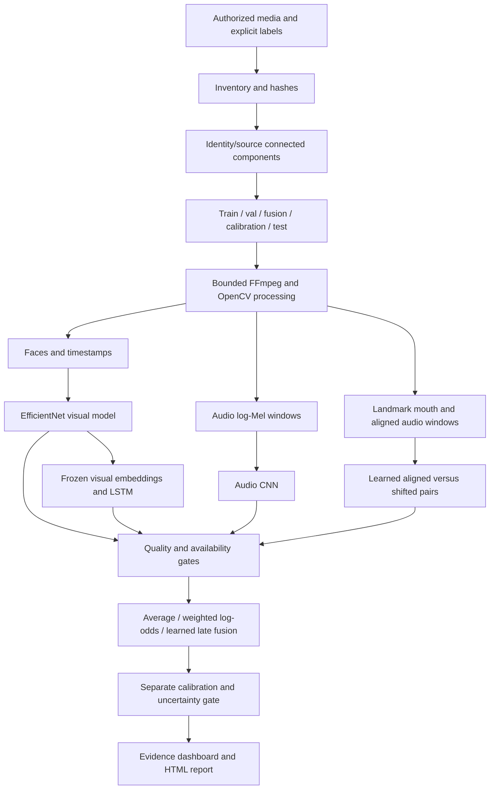

# Architecture and data flow

`data.py` validates label and provenance metadata. `split_manifest` uses union-find:
if two files share any identity/source, directly or through another derivative, they
remain together. This can produce a giant component and infeasible splits; collecting
better metadata or changing the study design is preferable to leakage. Group allocation
is seeded but not class-stratified; audit class counts and do not train single-class
partitions. Duplicate-content hashes are grouped by the CLI.

`media.py` probes duration, codec, FPS, dimensions and audio start offset. It decodes
frames at configured timestamps, accepts one Haar-detected face, rejects ambiguous
multiple faces and tracks overlapping boxes. This is a conservative baseline tracker,
not robust identity recognition. Mouth crops use actual MediaPipe landmarks only when
the external asset is present. The audio energy gate excludes silence; it is **not** a
validated speech VAD. Log-Mel values use a fixed range without test-set fitting.

Visual and audio models optimize video-level average logits over frames/segments.
Temporal learning freezes the trained visual encoder and rejects gaps. The synchronizer
uses 3D convolution streams over five mouth frames and five time-aligned Mel windows.
Its positive pairs are real/real; negative pairs shift audio within the same recording.
No heuristic mouth score substitutes for this model. A model must still demonstrate
offset discrimination on held-out genuine speech before its evidence is scientifically
useful.

Fusion fits regularized logistic regression on twelve features: four modality scores,
four quality measures and four availability bits. Missing scores have a neutral numeric
placeholder **with availability zero**, never a fabricated reported prediction. Sync
scores enter learned fusion as alignment evidence; direct averaging and weighted
log-odds exclude sync because mismatch is not a fake class label.

`inference.py` rejects incompatible settings and encoder/fusion hashes. Only calibrated
learned fusion can issue a final classification, and intermediate scores remain labeled
as model evidence. Quality and disagreement can force abstention. Thresholds are
provisional policy values requiring validation, not measured safety guarantees.

`app/main.py` exposes eight navigation sections, caches models by file modification
version, deletes temporary media and retains evidence only in session memory. No external
APIs or inference credentials are needed. Structured JSON, CSV and plots form local
experiment tracking without an additional database service.
