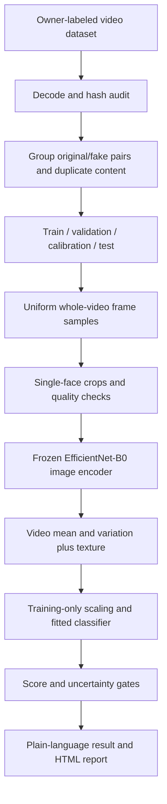

# Video-only architecture

`data.py` preserves owner labels, hashes inputs, probes media and splits filename-related
source pairs. All byte-identical copies are grouped; conflicting identical labels fail.
The grouping does not certify person/donor independence because those metadata were not
provided. The seed and split membership are fixed before final evaluation.

`media.py` validates size, duration, dimensions and video frame rate. Sixteen timestamps
cover the entire clip. Haar detection accepts one face per sample and skips ambiguous
frames. More than a quarter of sampled frames with several faces, insufficient faces,
or median sharpness below the configured gate causes abstention. The detector is a
limited baseline: false/missed boxes and pose sensitivity remain known risks.

`models.py` loads verified official ImageNet EfficientNet-B0 parameters. Its 1,280-wide
frame embeddings are summarized by mean and standard deviation; eight texture features
produce a 2,568-dimensional video representation. A fitted standardized logistic head
is stored as safe JSON. Filename, class name and file-size metadata are never model
features. The backbone is frozen; the head is genuinely trained on owner media.

`training.py` selects regularization using validation only, fits temperature on a
separate calibration split, evaluates raw/scaled scores and two simpler baselines, and
records all predictions and exclusions. Cached features make repeat runs inexpensive.
`evaluation.py` produces real metrics, source-group bootstrap intervals and curves.
`experiments.py` tests the same held-out inputs through actual inference and fixed visual
changes. These are robustness derivatives, not a new external dataset.

`inference.py` refuses inadequate faces/media, returns a raw model score, and uses a
predeclared uncertainty band plus a heuristic feature-distance gate. It recognizes exact
training-file hashes only to warn about nonindependent demos; that lookup never changes
the predicted score. Unknown-source accuracy is not established. `reporting.py` escapes
untrusted text in portable HTML reports.

`app/main.py` has six pages: Start, Check a video, Your result, How reliable is it?, Our
dataset, About this project. Models are cached by checkpoint modification version.
Temporary disk uploads are removed even after exceptions. Clear video and result resets
session evidence and the uploader. No remote inference service is required.
